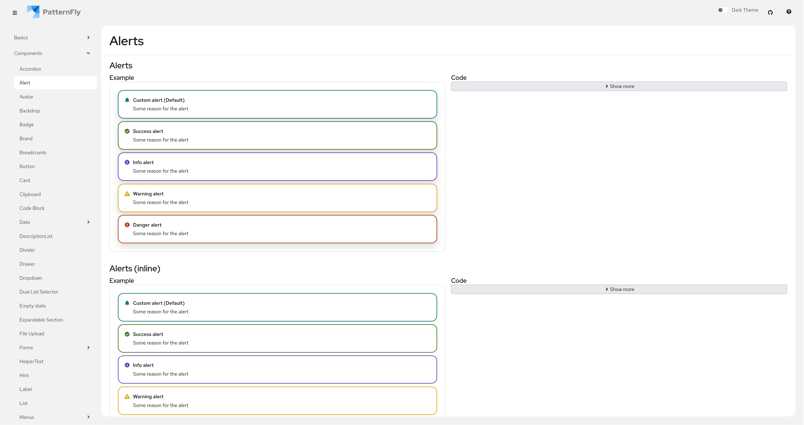

# PatternFly components for Yew

[Yew](https://yew.rs/) components, based on [PatternFly](https://www.patternfly.org):

> PatternFly is an open source design system built to drive consistency and unify teams.

> Yew is a framework for creating reliable and efficient web applications.

---

## Getting started

Take a look at the demo, which shows various features of the project: https://patternfly-yew.github.io/patternfly-yew-quickstart

The code of the demo is also intended to be a quickstart/template project, to get you started with just a few commands: https://github.com/patternfly-yew/patternfly-yew-quickstart

## Migrating to 0.9

Version 0.9 replaces Chrono with [Jiff](https://docs.rs/jiff/1/). Update your
application's dependency to `jiff = "1"` and migrate date component properties:

| Before | After |
| --- | --- |
| `chrono::NaiveDate` | `jiff::civil::Date` |
| `chrono::Weekday::Mon` | `jiff::civil::Weekday::Monday` |
| `NaiveDate::from_ymd_opt(2024, 2, 29).unwrap()` | `Date::new(2024, 2, 29).unwrap()` |
| `chrono::DateTime<chrono::Utc>` | `jiff::Timestamp` |
| `chrono::Utc::now()` | `jiff::Timestamp::now()` |

`CalendarView` and `DatePicker` use civil dates for values, range starts and
callbacks. `Timestamp` accepts a Jiff timestamp for its `date` property. Jiff's
supported years are -9999 through 9999.

With the `localization` feature, calendar labels use the browser's locale and
Gregorian calendar through `Intl`; native rendering uses English labels.
